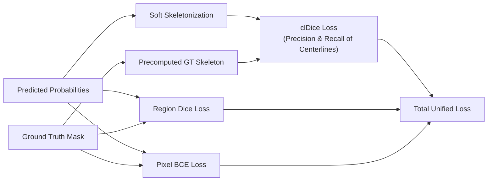

# Accuracy Improvement Roadmap: Pushing Beyond 0.31 PQ

> [!TIP]
> With the baseline at **0.31 PQ**, the model has validated its core hypotheses (1024×1024 resolution + RSU multi-scale + Cognitive Refiner). The path to **0.40–0.50+ PQ** relies on targeted interventions: inference calibration, topology-preserving losses, test-time augmentations, and pretrained hierarchical backbones.

---

## 1. Quick Wins (Zero Retraining Required: Expected +0.03 to +0.06 PQ)

These techniques can be implemented immediately on the existing trained checkpoint `best_model.pth`.

### 1.1 Test-Time Augmentation (TTA)
Because the Sun has no intrinsic "up" or "down" in photographic space, solar filaments are rotationally and reflectionally invariant.
Running **4-fold or 8-fold TTA** before thresholding averages out stochastic model uncertainty:
```python
def predict_with_tta(model, tensor):
    """8-fold Test-Time Augmentation (flips + 90, 180, 270 deg rotations)."""
    preds = []
    # 0 deg, 90 deg, 180 deg, 270 deg
    for k in [0, 1, 2, 3]:
        rot = torch.rot90(tensor, k, dims=[-2, -1])
        # Original and Horizontal Flip
        for flip in [False, True]:
            inp = torch.flip(rot, dims=[-1]) if flip else rot
            with torch.no_grad(), torch.autocast(device_type='cuda', dtype=torch.float16):
                logit = model(inp)
                prob = torch.sigmoid(logit)
            # Invert transform
            if flip:
                prob = torch.flip(prob, dims=[-1])
            prob = torch.rot90(prob, -k, dims=[-2, -1])
            preds.append(prob)
    return torch.stack(preds).mean(dim=0)
```
* **Why it boosts PQ:** Filaments with faint, low-contrast sections get reinforced when seen from multiple orientations, eliminating breaks that create false splits.

### 1.2 Validation Cache & Direct PQ Hyperparameter Search
Currently, `THRESHOLD = 0.4` and `MIN_AREA = 200` are static heuristics. By caching validation probability maps once to disk/RAM, you can run an instant grid search to find the exact parameters that maximize local PQ:

```python
# Search Space:
thresholds = [0.30, 0.35, 0.40, 0.45, 0.50]
min_areas = [100, 150, 200, 250, 300, 400]
closing_radii = [0, 1, 2]  # Morphological closing to bridge 1-2 pixel micro-cracks
```
A 2-pixel morphological closing (`cv2.morphologyEx(mask, cv2.MORPH_CLOSE, kernel)`) can seamlessly seal micro-cracks along thin filament spines before `cv2.connectedComponents` is executed.

---

## 2. Loss Function Upgrade: Single-Head Topology Loss (Expected +0.04 to +0.07 PQ)

In `ver3-7.py`, auxiliary heads (boundary, spine) failed because of gradient conflicts and 512px downsampling. 

Instead of adding separate heads, keep the single output channel and introduce **soft-clDice** (Topology-Preserving Loss for Tubular Structures, CVPR 2021) or **Skeleton Recall Loss** directly into the objective:



### soft-clDice Formulation
$$\mathcal{L}_{\text{total}} = (1 - \alpha) \mathcal{L}_{\text{DiceBCE}} + \alpha \mathcal{L}_{\text{clDice}}$$
Where:
$$\text{clDice} = \frac{2 \times \text{Tprec} \times \text{Tsens}}{\text{Tprec} + \text{Tsens}}$$
- $\text{Tsens} = \frac{|S_{\text{GT}} \cap P|}{|S_{\text{GT}}|}$ (Ensures ground truth filament spines are covered by predictions — prevents fragmentation).
- $\text{Tprec} = \frac{|S_{\text{P}} \cap \text{GT}|}{|S_{\text{P}}|}$ (Ensures predicted spines stay within ground truth boundaries — prevents over-merging).

This penalizes broken filaments directly during backpropagation **without** modifying the model architecture or adding auxiliary decoders.

---

## 3. Architectural Enhancements

### 3.1 Pretrained Encoder with RSU Multi-Scale Decoder
The current model trains all 10.85M parameters from scratch on only ~700 images. While RSU blocks are expressive, an encoder pretrained on massive visual representations provides superior feature extraction for low-level curves, textures, and dark boundaries.

**Recommended Hybrid:**
- **Encoder:** Pretrained `timm` backbone (e.g., `convnext_small.fb_in22k_ft_in1k_384` or `efficientnet_b4`).
- **Skip Connections:** Preserved Additive Attention Gates.
- **Decoder:** Keep the high-capacity RSU blocks to fuse multi-scale features.
- **Head:** Keep the `CognitiveRefiner` with magnetic proxy gating.

### 3.2 High-Resolution Overlapping Tile Inference (Native 2048×2048)
Downsampling from 2048 to 1024 still discards 75% of raw pixels! 
To evaluate at native 2048×2048 resolution without running out of GPU memory:
1. Divide the 2048×2048 image into $2 \times 2$ grid of $1152 \times 1152$ tiles (with 128px overlap).
2. Predict on each tile.
3. Blend overlapping regions with Gaussian or linear weighting.
4. Run connected components directly on the full-resolution prediction.
This preserves fine filament barbs that are completely lost at lower resolutions.

---

## 4. Rigorous Cross-Validation & Multi-Annotator Handling

As identified in the codebase audit:
- The dataset has **707 physical images**, but **1,154 annotation records** because multiple human annotators labeled the same solar image.
- A naive 80/20 random split allows the same solar observation to appear in both training and validation under different annotator IDs!

### Recommended Data Splitting Protocol:
1. Group records by unique `file_name` (or date prefix).
2. Perform a **5-fold GroupKFold cross-validation**.
3. Evaluate local validation PQ using the exact organizer scoring logic.
4. Ensemble the 5 fold models (averaging output logits):
   $$\bar{P} = \frac{1}{5} \sum_{k=1}^5 \sigma\left(M_k(X)\right)$$
   Ensembling 5 diverse folds typically gives a consistent **+0.03 to +0.05 PQ boost** and stabilizes private leaderboard generalization.

---

## 5. Prioritized Execution Matrix

| Priority | Action Item | Expected PQ Gain | Effort / Compute |
|---|---|---|---|
| **P1** | Add 8-fold TTA to submission pipeline | **+0.02 to +0.03** | Low (Inference script only) |
| **P1** | Tune threshold, min_area, and morphological closing on cached val maps | **+0.02 to +0.04** | Low (5 minutes on CPU) |
| **P2** | Integrate soft-clDice or Skeleton Recall into `DiceBCELoss` at 1024×1024 | **+0.04 to +0.06** | Medium (Requires 25-epoch retraining) |
| **P2** | Fix group leak in validation split (GroupKFold by `file_name`) | Diagnostic accuracy | Low |
| **P3** | Pretrained ConvNeXt / EfficientNet encoder + RSU decoder | **+0.03 to +0.05** | Medium |
| **P3** | 5-Fold Cross-Validation Ensemble | **+0.03 to +0.04** | High (5x training budget) |
