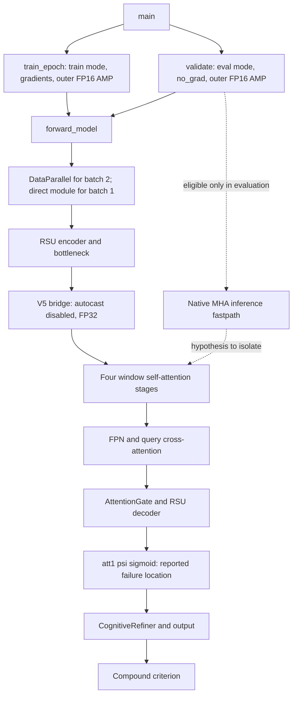

# V5 CUDA failure: RCA and implementation plan

Implementation follow-up: see [V5 Kaggle runbook](V5-Kaggle-runbook.md) for the implemented controls, recovery format, local checks and remaining T4 acceptance runs. The investigation below describes the source before implementation; its source fingerprints and line references are historical.

Investigated 26 October 2026. Investigation and planning only; no model code changed and no Kaggle experiments executed.

User decisions: preserve the current V5 architecture; optimize stability and speed around it. The original script completed on the same stated PyTorch 2.11.0+cu128 / two-T4 setup, and 0.31 is its public leaderboard score. The exact scoring metric behind that public value was not independently verified here.

## Finding

**Confirmed:** a CUDA misaligned memory access is reported during V5 validation on GPU 1. **Not confirmed:** which kernel first makes the invalid access. The traceback identifies an observation point, not necessarily the originating kernel.

The highest-value diagnostic is the execution-path change introduced by V5's FP32 self-attention bridge: evaluation plus disabled gradients plus explicitly disabled autocast makes its window attention eligible for native MHA inference fastpath. Training is ineligible. V5's existing SDPA backend switches do not disable that separate fastpath. This explains a plausible training/evaluation asymmetry; it does not prove that MHA caused this failure.

The original's success on the same stated runtime makes a blanket claim that PyTorch 2.11 or DataParallel is broken untenable. It strengthens the case for isolating V5-specific paths and their interactions before changing versions.

## Evidence from the logs

| Observation | Consequence |
|---|---|
| Paths exist, 707 physical training images, 180 test images | Initialization and basic file discovery succeeded. |
| 1,154 records across 707 physical images | Some images have multiple annotation records; records are not independent photographs. |
| 925 train records / 565 files; 229 validation records / 142 files | Consistent with V5's split by physical filename. |
| All 462 training batches finish, about 517.8 seconds | About 1.12 seconds per loader batch; 924 records consumed with `drop_last=True`. |
| Batch 2, accumulation 2 | One image per GPU per forward; effective optimizer batch 4; 231 update opportunities in epoch 1. GradScaler may skip nonfinite updates. Accumulation does not increase the BatchNorm batch. |
| Validation reaches 1/115, then fails | Failure is while processing the second batch, or an earlier asynchronously reported operation. It is not the final one-record batch. |
| Replica 1, `att1` → `psi` → sigmoid | GPU 1 reports the error before the failing forward returns to the loss. |
| `CUDA error: misaligned address` | This is not the reported signature of an out-of-memory error. No memory trace establishes a leak or exhaustion. |
| Epoch 1 has Lovasz weight zero | Lovasz is skipped in that epoch; the failing validation call does not reach its criterion. It is not the leading explanation. |
| HF download/preload completes around 53.3 seconds | Authentication warnings did not prevent initialization. They are unrelated to the device crash. |
| Papermill and nbconvert messages appear afterward | Papermill propagates the notebook failure; conversion warnings do not explain it. |

Only one validation batch completes, so there is no credible full-validation runtime estimate. Training alone at the observed average would take roughly 3.6 hours for 25 epochs, excluding validation, initialization and submission. Later Lovasz-enabled epochs may differ substantially. Repeated tqdm lines are log rendering, not proof that batches execute twice. Alternating batch times are consistent with optimizer work every second batch, without proving that it is the only source of variation.

NVIDIA defines this error as an unaligned device load/store and requires termination and relaunch of the affected process. In Kaggle, restart the kernel/session before another experiment; `empty_cache()` and retrying within the failed process are not recovery. [NVIDIA CUDA error definitions](https://docs.nvidia.com/cuda/cuda-runtime-api/cuda_runtime_api/group__CUDART__TYPES.html).

CUDA launches are asynchronous, so a later sigmoid can expose an earlier kernel error. Use launch blocking for diagnosis, then remove it for performance measurements. [PyTorch 2.11 CUDA semantics](https://docs.pytorch.org/docs/2.11/notes/cuda.html#asynchronous-execution).

## Source trace and baseline comparison

Current source anchors:

- [AttentionGate](../heavy-models/V5-heavy-model.py#L470), [HieraWindowStage](../heavy-models/V5-heavy-model.py#L559), [VLMSemanticBridge](../heavy-models/V5-heavy-model.py#L608).
- [Model forward](../heavy-models/V5-heavy-model.py#L949), [shared forward wrapper](../heavy-models/V5-heavy-model.py#L1134), [training](../heavy-models/V5-heavy-model.py#L1155), [validation](../heavy-models/V5-heavy-model.py#L1203).
- [Inference](../heavy-models/V5-heavy-model.py#L1266), [backend setup](../heavy-models/V5-heavy-model.py#L1427), [checkpoint functions](../heavy-models/V5-heavy-model.py#L1443), [main](../heavy-models/V5-heavy-model.py#L1461).
- [Successful original](../heavy-models/solar_filament_segmentation_mag_agent_u_net_heavy-original-0.31.py).

The current diagram is reconstructed from source. Graphify was queried, but its stored V5 nodes say `main` at L687 and `validate` at L555 and omit the new bridge. Its manifest gives old V5 and original the same AST hash. It indexes an earlier copy and cannot substantiate today's bridge path. A correction was saved to graphify memory; rebuilding the full graph is unnecessary for this investigation.

| Area | Successful original | Current V5 | Decision |
|---|---|---|---|
| AttentionGate, RSU | CNN gates and blocks | AST-identical definitions | Reuse; copying them again cannot fix this crash. |
| Parallelism/precision | DataParallel, FP16 AMP | Same outer strategy, FP32 bridge added | Diagnose interactions rather than remove AMP globally. |
| Bridge | Absent | Four custom window stages, FPN, queries, FiLM | Preserve architecture per user instruction. |
| Input | H-alpha repeated twice plus proxy | H-alpha, valley map, proxy | Keep; evaluate preprocessing speed separately. |
| Sampling | Full-disk views | Full disk and native crops | Keep. |
| Objective | Dice + BCE | Dice + focal + warmed Lovasz + spine + bridge auxiliary | Keep training objective; improve monitoring/selection separately. |
| Split | Ordered record split | Seeded grouping by physical filename | Keep V5; original split does not guarantee filename separation. |
| Submission | One 1024 view | Global TTA plus nine native tiles | Keep path; benchmark its actual cost. |
| Epoch recovery | Best checkpoint after validation | Also after validation; bridge initialized separately | Add a recoverable last-training checkpoint before validation. |

Keep the original's proven operating choices: 1024 resolution, AMP, batch 2 / accumulation 2, pinned transfer, unscale before gradient clipping, connected components and COCO RLE. V5 already has these; they are not new optimization opportunities. Do not copy the original's record split, per-batch `loss.item()` synchronization, or threshold-before-upscale inference.

## Ranked crash hypotheses

### 1. Native MHA inference fastpath or its interaction with replication

**Priority: first isolation test. Confidence in eligibility: high; confidence in causation: unproven.**

`HieraWindowStage` passes the same normalized tensor as Q/K/V, uses `batch_first=True`, even head counts and no masks. Its enclosing bridge explicitly disables autocast and casts inputs to FP32. During validation, `.eval()` and `no_grad()` satisfy the key additional fastpath conditions. Training disables this path.

PyTorch documents these conditions and implements a separate call to `torch._native_multi_head_attention`. The public `torch.backends.mha.set_fastpath_enabled(False)` switch controls that route. Existing `enable_flash_sdp(False)`, `enable_mem_efficient_sdp(False)` and `enable_cudnn_sdp(False)` control SDPA choices, not this MHA eligibility switch. [MHA documentation](https://docs.pytorch.org/docs/2.11/generated/torch.nn.MultiheadAttention.html), [PyTorch 2.11 implementation](https://github.com/pytorch/pytorch/blob/v2.11.0/torch/nn/modules/activation.py), [MHA backend switch](https://docs.pytorch.org/docs/2.11/backends.html#torch.backends.mha).

First experiment: change only the MHA fastpath switch at process setup, before GPU forwards. Preserve architecture, weights, eval mode, FP32 bridge and current SDPA settings. A passing run identifies a useful workaround; repeat before calling it causal. No directly matching upstream issue establishing this exact T4 / 2.11 / V5 fault was found in the search.

### 2. FP16 evaluation convolution/BatchNorm kernel or layout interaction

**Priority: second if synchronized trace remains in the decoder.**

`psi` runs Conv2d → BatchNorm2d(1) → sigmoid. Evaluation changes BatchNorm execution, and V5 changes upstream activations, dtypes and allocation pressure even though this gate's source is unchanged. Capture shape, dtype, strides, storage offset, device and finiteness at the first failing boundary. Contiguity alone does not establish pointer alignment or prove a backend safe.

Test AMP-off evaluation separately, then targeted FP32 execution or cuDNN-disabled evaluation if localization supports it. These are diagnostic variants, not proposed blanket defaults. Avoid changing all three simultaneously.

### 3. Multi-GPU execution interaction

**Priority: controlled comparison, not assumed root cause.**

Repeat the same records/weights on each GPU individually and then through DataParallel. Passing each device alone but failing replicated execution implicates the parallel path or its backend interaction. A failure only on one device warrants checking that session/device separately. GPU 1 being named in one traceback does not establish defective hardware.

The wrapper's singleton bypass cannot explain batch 2 of validation: both initial batches have two records. Its `_dp_return_aux` attribute is set before replication and restored after the call; there is no demonstrated race from the current sequential callers. PyTorch supports propagated autocast in DataParallel threads, so moving every autocast context into `forward` is not a justified first fix. [PyTorch AMP examples](https://docs.pytorch.org/docs/2.11/notes/amp_examples.html#working-with-multiple-gpus).

## Definite issues discovered independently of the crash

1. **Unsafe pretrained loading.** `_copy_matching_tensors` accepts equal shape and the last key segment, then greedily takes the first unused source. This can assign unrelated normalization, projection or bias tensors. “60 tensors loaded” measures copies, not semantic correctness or parameter coverage. The local four-block architecture is not the actual SAM 2 Hiera Tiny trunk: Meta specifies stages `[1, 2, 7, 2]`, with other structural differences. Preserve V5's custom bridge but replace heuristic loading with explicit, role-compatible mappings only, missing/unexpected-key reporting, parameter coverage and source provenance. Leave unmapped tensors intentionally initialized. Do not transplant the real SAM backbone under an architecture-preservation request. [Official SAM 2 config](https://github.com/facebookresearch/sam2/blob/main/sam2/configs/sam2/sam2_hiera_t.yaml), [official Hiera implementation](https://github.com/facebookresearch/sam2/blob/main/sam2/modeling/backbones/hieradet.py).
2. **Misleading semantic labels.** The active bridge uses visual features and learned/random query anchors. Imported CLIP text classes are unused; no text encoder or language grounding appears in the active path. Correct comments/log claims without changing the architecture. Random normalized vectors are not physics-informed text embeddings.
3. **Completed epoch is not recoverable.** Best weights are saved only after validation. The initial `best_vlm.pth` is not the completed epoch's bridge. Save one coherent last-training checkpoint before validation, including both model parts, optimizer, scaler, scheduler state/step position, epoch, RNG and split/config identity. Keep best-for-inference and last-for-resume distinct. Do not write after a fatal CUDA error.
4. **Checkpoint provenance is weak.** Startup loads any existing `best_vlm.pth` into a freshly initialized main network without verifying a matching run. Inference loads the main network with `strict=False`, and a missing bridge file is tolerated. Require coherent run/epoch metadata and required keys for inference; partial transfer must be explicit. Validate the pair before generating a submission.
5. **Validation selection changes objective across epochs.** The raw validation loss includes an increasing Lovasz coefficient. Comparing epoch 1 directly with epoch 5 mixes model changes and objective changes. Keep the training warmup, but select best using a fixed validation objective or a clearly defined metric; log individual terms. Weight aggregate reporting by record count so the singleton final batch is not weighted like a full batch.
6. **Broken image reads silently become random solar inputs.** Fail with the filename or use an explicit, counted exclusion policy. Random replacement can silently harm training and create meaningless submission rows. No log evidence says it triggered this crash.
7. **Inference policy is not validated by current validation.** Training checkpoint selection uses downscaled views; submission uses tiled/global fusion, a hard global cutoff and closing. The expression `(p_global > 0.05).float()` is a hard gate despite “soft gate” comments. It can suppress a correct local prediction. Compare output metrics at native resolution before tuning threshold, blend or closing. Do not change these during crash isolation.

## Implementation sequence

### Phase 0 — Capture a reproducible failing case

Keep the two original source files unchanged as comparison inputs. Record source hash, package versions, cuDNN version, driver, both GPU properties, backend flags, split order, exact record IDs and checkpoint provenance. Notebook metadata timestamps are not a source/version identifier.

In a fresh Kaggle process, set `CUDA_LAUNCH_BLOCKING=1` before CUDA initialization. Capture the first few validation records to CPU before executing them. Run evaluation before a full epoch to see whether initialization alone reproduces the problem. If it requires trained weights, save the complete state immediately before validation on the next controlled run.

Use temporary device-aware synchronization boundaries after bridge stages, FPN, attention gates and around the reported Conv/BN/sigmoid sequence to locate the earliest failing operation. Remove them after diagnosis. Keep finite-value checks and input IDs available in that diagnostic run. Do not mix debug timing with throughput results.

### Phase 1 — One-variable test matrix

Every fatal-error row requires a fresh process for the next row. Reuse fixed weights, inputs, backend settings and seeds wherever possible.

| Test | Single difference from control | What it resolves |
|---|---|---|
| A | Current V5, synchronous diagnostics | Earliest failure; reproducibility. |
| B | Disable native MHA fastpath only | Whether that inference route is necessary for the failure. |
| C | Run control serially on GPU 0, then GPU 1 | Per-device versus replicated failure. Use one-image microbatches to fit; reassemble logits before computing the same batch criterion. |
| D | Disable AMP for evaluation, one-image microbatches if required | Precision-related path; compare with matching serial control as needed. |
| E | Disable cuDNN for evaluation | cuDNN contribution, only if decoder localization justifies it. |
| F | Original script in the current Kaggle session environment | Reconfirm user-reported runtime control if A–E remain ambiguous. |

If B resolves the fault, retain that small switch and stop adding unrelated crash workarounds. If replicated eval alone is implicated, a serial-evaluation fallback preserves two-GPU training and all V5 layers. Benchmark it and preserve full-batch loss semantics. Do not use `model.train()` to bypass evaluation: it changes BatchNorm behavior and contaminates validation statistics.

Only consider a runtime upgrade/downgrade after a minimal reproducer identifies a backend regression. Pin a mutually compatible tested environment, rather than guessing a PyTorch version or rebuilding PyTorch with device assertions as the first action.

### Phase 2 — Correctness and recovery, same architecture

Implement the explicit preload mapping/provenance and coherent checkpoints above. Continue using the existing `forward_model` entry point for training, validation, prediction/TTA and visualization. Keep the singleton route until its behavior is verified; simplify the mutable auxiliary flag only if a reproducer shows it is implicated.

Keep the physical-file split, loss terms, bridge, FiLM, decoder and crop strategy. Fix monitoring and checkpoint selection without replacing the model. Add a small check that unrelated equal-shape weights cannot be accepted, and a save/load round-trip that reproduces eval logits for both batch sizes.

### Phase 3 — Optimize measured bottlenecks

Measure data wait, host-to-device transfer, forward, criterion, backward and optimizer time after warmup. Record median/p95 batch latency, full epoch time and peak allocated/reserved memory **on both GPUs**. Use CUDA events or synchronization for GPU measurements. A 10% improvement in full epoch time with unchanged correctness is a useful promotion threshold; smaller changes can still be accepted if effectively free, but do not accumulate complex optimizations for noise.

| Order | Candidate | Constraint |
|---|---|---|
| 1 | Reduce tqdm refresh frequency; retain GPU-side loss accumulation | Low risk; batch-by-batch `item()` synchronization from the original should not return. |
| 2 | Try persistent DataLoader workers; measure 2 versus 4 workers | Current comment says 4 but value is 2. Do not assume additional workers help. Guard persistent workers when worker count is zero. |
| 3 | Cache repeated deterministic work by physical filename | Prefer validation preprocessing or bounded/disk caching first. Preserve annotation-specific masks and random training crops/augmentations. |
| 4 | Benchmark `cudnn.benchmark=True` after stability | Most model shapes are fixed; it changes algorithm selection, so rerun train/eval and singleton checks. |
| 5 | Profile the all-FP32 bridge and forced math attention | Reintroduce AMP selectively only if this dominates runtime, keeping sensitive reductions/loss in FP32. This is an opt-in measured experiment after stabilization. |
| 6 | Test an available efficient SDPA backend separately | Probe support on the actual T4, dtype and head dimensions. Do not assume FlashAttention/BF16 recommendations for newer GPUs apply here. |
| 7 | Compare serial and DataParallel evaluation/inference; DDP only if profiling justifies it | Batch 2 gives only one image per GPU; replication has a cost. DDP introduces launcher/sampler/checkpoint complexity and is deferred. |

PyTorch recommends workload-based worker tuning and pinned transfers, and describes cuDNN autotuning for convolution workloads. These are candidates to benchmark, not promised speedups. [Performance tuning guide](https://docs.pytorch.org/tutorials/recipes/recipes/tuning_guide.html), [DataLoader options](https://docs.pytorch.org/docs/2.11/data.html#torch.utils.data.DataLoader).

Important cost bounds:

- Stage 1 has 256 windows per image, 256 tokens per window and 4 heads. A materialized FP32 attention-score tensor alone is about **256 MiB per GPU/image**, before QKV, gradients and other activations. This is a theoretical tensor-size bound, not measured total memory. Math SDPA retains FP32 intermediates even for half inputs, so simply enabling AMP does not guarantee eliminating that cost. [SDPA precision behavior](https://docs.pytorch.org/docs/2.11/generated/torch.nn.functional.scaled_dot_product_attention.html).
- Unbounded native FP32 three-channel caches for 707 images would take about **33.1 GiB**, excluding masks, Python overhead and worker duplication. Do not replace GPU overhead with host-memory exhaustion. Crop-local min/max normalization differs from full-image preprocessing, so caching full prepared images can change training values and requires equivalence checks.
- Current submission performs four global TTA predictions plus nine tile predictions: **13 image-view equivalents per test image**, versus one in the original. At tile batch 2 this is nine model calls: four global calls plus five tile calls. Benchmark this actual implementation; it is not 40 views. Preserve it for the requested plan and use reduced-view inference only as a separately scored experiment.
- Lovasz starts at epoch 2 and sorts roughly one million pixel errors per training view. Measure a warmed epoch before and after activation; epoch 1 throughput is not the final cost.

Do not start with channels-last, `torch.compile`, new attention libraries, blanket `.contiguous()` calls, per-batch cache clearing, lower resolution or a larger batch. Each adds another variable or changes operating behavior before the current fault is understood. Consider compilation/layout changes only if profiling subsequently gives a concrete reason.

### Phase 4 — Acceptance criteria

1. Reproduce the control failure, or explicitly record inability to reproduce it; never label a workaround “confirmed root cause” merely because one run passed.
2. Complete all 115 validation batches, including the one-record tail, repeatedly with fixed weights and finite outputs.
3. Complete train → eval → train transitions and at least epochs 1–2 so warmed Lovasz is exercised. Compare the modified numerical path against a stable reference with documented tolerances; backend changes need not be bitwise identical.
4. Exercise direct batch 1 and replicated batch 2, auxiliary and plain outputs, flips/rotation, all nine tiles including the odd tile tail, and visualization.
5. Verify coherent checkpoint resume and inference reload. Reject missing/mismatched bridge weights and unrelated equal-shape pretrained tensors.
6. Run native-resolution holdout inference using the actual submission fusion. Report pixel/instance metrics with a specified multi-annotator policy, split/merge counts and runtime. Do not compare V5's new local validation loss directly with the original's public 0.31.
7. Complete the 180-image submission pipeline within the actual Kaggle budget; verify schema, decodable RLE, dimensions, filenames and finite probabilities. Images with no components need explicit accounting, not necessarily a submission row.
8. Complete the intended 25-epoch run before declaring the full pipeline fixed. The short gate prevents spending hours on an immediately broken evaluation path; it does not replace final completion.

## Grilling decisions and remaining uncertainty

- **Must the architecture survive?** Yes, user confirmed. Bridge removal/replacement is excluded.
- **Is the successful baseline comparable at the runtime level?** Yes, user confirmed the stated setup. Its public 0.31 is useful outcome evidence, not proof of V5's local metric quality.
- **What would falsify the leading hypothesis?** Persistent failure with native MHA fastpath disabled, especially a synchronized error localized elsewhere. Follow that evidence.
- **Can a public “60 tensors loaded” message justify pretrained semantics?** No. Require role-compatible mapping and coverage.
- **What remains unavailable?** Live failing Kaggle tensors/checkpoints, driver/cuDNN details, synchronized trace, per-device memory profile and runtime experiments. Static analysis cannot settle the exact faulting kernel.

The minimum architecture-preserving patch to try is the isolated MHA fastpath switch, followed by a full validation check. The minimum durable work also needs truthful weight loading and recoverable checkpoints. All broader optimization remains conditional on measurements.

Source fingerprints at analysis time: V5 SHA-256 `dfaf57db7379cb5793af69e07301543bba938cbf50a29c1b19a1bebac7a9a11d`; original SHA-256 `8e7b2afa5f7c493f9a9ca4f51d74e60f6e0becc6aa809c62936e50a705771f81`.
