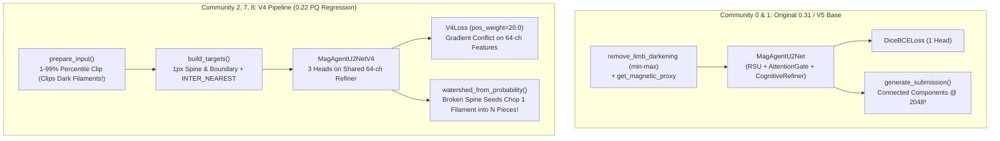
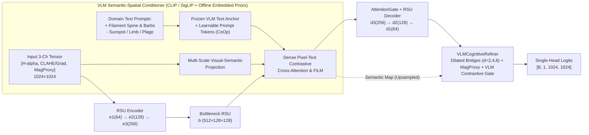

# V5 Heavy Model Implementation Plan: VLM-Guided Mag-Agent U²-Net

> [!IMPORTANT]
> **Goal:** Upgrade [`V5-heavy-model.py`](file:///Users/vinodpandey/solar-filament-segmentation/heavy-models/V5-heavy-model.py) (currently a clean copy of the **0.31 PQ** baseline [`solar_filament_segmentation_mag_agent_u_net_heavy-original-0.31.py`](file:///Users/vinodpandey/solar-filament-segmentation/heavy-models/solar_filament_segmentation_mag_agent_u_net_heavy-original-0.31.py)) by fixing every regression that caused [`V4-heavy-model.py`](file:///Users/vinodpandey/solar-filament-segmentation/heavy-models/V4-heavy-model.py) to drop to **0.22 PQ**, and integrating **Vision-Language Model (VLM) contrastive prompt & dense feature conditioning** into the Mag-Agent U²-Net architecture.

---

## 1. Problem Statement & Complete Audit of `heavy-models/`

### 1.1 Kaggle Competition Problem Statement
- **Competition:** *Solar Filament Segmentation Challenge 2026* (MAGFiLO 1.0 dataset on GONG $H\alpha$ $2048 \times 2048$ full-disk solar observations).
- **Dataset:** 707 unique physical `.jpeg` training images referenced by 1,154 COCO image records (8,199 instance annotations with polygon masks and polylines `spine`), plus ~180 test images.
- **Primary Evaluation Metric:** **Panoptic Quality ($\text{PQ} = \text{SQ} \times \text{RQ}$)** at $\text{IoU} \ge 0.50$, plus pixel-level Dice:
  $$\text{PQ} = \underbrace{\frac{\sum_{(p, g) \in \text{TP}} \text{IoU}(p, g)}{|\text{TP}|}}_{\text{Segmentation Quality (SQ)}} \times \underbrace{\frac{|\text{TP}|}{|\text{TP}| + \frac{1}{2}|\text{FP}| + \frac{1}{2}|\text{FN}|}}_{\text{Recognition Quality (RQ)}}$$
- **Strict Constraints:** Inference uses only $H\alpha$ test images (`2048×2048`), outputs Fortran-contiguous `pycocotools` RLE masks per predicted filament instance (`filament_id`, `segmentation_rle`), and must run within Kaggle's dual-T4 GPU memory (16 GB × 2) and runtime limits.

### 1.2 Audit of All 6 Files in `heavy-models/`

| File | Architecture & Input | Supervision & Decoding | Status / Role |
|---|---|---|---|
| [`solar_filament_segmentation_mag_agent_u_net_heavy-original-0.31.py`](file:///Users/vinodpandey/solar-filament-segmentation/heavy-models/solar_filament_segmentation_mag_agent_u_net_heavy-original-0.31.py) | `MagAgentU2Net` (10.85M params): 3-ch `[H-alpha, H-alpha, MagProxy]`, `RSU` encoder/decoder, `AttentionGate`, `CognitiveRefiner` | Single-head `DiceBCELoss`, 25 epochs, connected components (`THRESHOLD=0.4`, `MIN_AREA=200`) | **0.31 PQ Baseline** (proven working anchor) |
| [`heavy-ver-2-without-magnetic-proxy-and-agent.py`](file:///Users/vinodpandey/solar-filament-segmentation/heavy-models/heavy-ver-2-without-magnetic-proxy-and-agent.py) | 1-ch `[H-alpha]` only; removes `get_magnetic_proxy` and `CognitiveRefiner` | Single-head `DiceBCELoss`, connected components | Ablation baseline proving the Magnetic Proxy + Cognitive Refiner are essential |
| [`heavy-ver-3-improved-accuracy-with-proxy-agent.py`](file:///Users/vinodpandey/solar-filament-segmentation/heavy-models/heavy-ver-3-improved-accuracy-with-proxy-agent.py) | 3-ch `[Radial-Limb H-alpha, CLAHE Local Contrast, MagProxy]` + `MagAgentU2Net` | `Dice + BCE + 0.1 * soft-clDice`, 60 epochs, 8-fold TTA | Added radial profile division (which amplified limb ring artifacts) + CLAHE + TTA |
| [`V4-heavy-model.py`](file:///Users/vinodpandey/solar-filament-segmentation/heavy-models/V4-heavy-model.py) | `MagAgentU2NetV4`: 3 heads (`foreground`, `boundary`, `spine`) off shared 64-ch `CognitiveRefinerFeatures` | Group split (565 train files), random 1-annotator sampling, `pos_weight=20` aux BCE, spine-seeded watershed | **Dropped to 0.22 PQ** (see Section 2 autopsy) |
| [`only-inference-code-V4.py`](file:///Users/vinodpandey/solar-filament-segmentation/heavy-models/only-inference-code-V4.py) | Identical to `V4-heavy-model.py` model/decoder | Loads saved V4 checkpoint and calibrates watershed/components on cached dev logits | Standalone inference script for V4 |
| [`V5-heavy-model.py`](file:///Users/vinodpandey/solar-filament-segmentation/heavy-models/V5-heavy-model.py) | Currently an exact copy of `original-0.31.py` | Target file for our V5 VLM + Mag-Agent U²-Net implementation | **Target for V5** |

---

## 2. Graphify Bottleneck Analysis & Autopsy of V4's Drop (0.31 $\rightarrow$ 0.22)

Running `graphify` across `/Users/vinodpandey/solar-filament-segmentation/heavy-models` extracted **307 AST nodes, 513 edges, and 9 communities** ([`GRAPH_REPORT.md`](file:///Users/vinodpandey/solar-filament-segmentation/graphify-out/GRAPH_REPORT.md)).

### Why V4 Dropped from 0.31 to 0.22 (4 Code-Verified Root Causes)

1. **Fatal Bug #1 — `1%–99%` Percentile Clipping Erased Filament Cores ([`V4-heavy-model.py#L120-L127`](file:///Users/vinodpandey/solar-filament-segmentation/heavy-models/V4-heavy-model.py#L120-L127)):**
   - Solar filaments occupy **$<1.5\%$ of the solar disk** and are the **darkest pixels on the disk**.
   - Original 0.31 used `min-max` normalization inside the disk, preserving the full dark dynamic range of filaments.
   - V4 replaced this with `low, high = np.percentile(pixels, (1, 99))` and `np.clip(...)`, which **clipped the darkest 1% of solar disk pixels (the filament spines and sunspot umbrae) to `0.0`**, destroying contrast between filaments and sunspots and erasing internal barb structure.
2. **Fatal Bug #2 — 1-Pixel Spine Downsampled with `INTER_NEAREST` + `pos_weight=20.0` Gradient Conflict ([`V4-heavy-model.py#L187-L246`](file:///Users/vinodpandey/solar-filament-segmentation/heavy-models/V4-heavy-model.py#L187-L246), [`L364-L404`](file:///Users/vinodpandey/solar-filament-segmentation/heavy-models/V4-heavy-model.py#L364-L404)):**
   - `rasterize_spine` drew a 1-pixel wide polyline at $2048 \times 2048$, then `resize_target` downsampled it to $1024 \times 1024$ with `cv2.INTER_NEAREST`. Downsampling a 1-pixel line by $2\times$ with nearest-neighbor drops ~50% of pixels, turning continuous spines into **disconnected dotted lines**.
   - Worse, `foreground_head`, `boundary_head` (outer contour), and `spine_head` (1px centerline) were all `1×1` convolutions attached to the **same 64-channel `CognitiveRefinerFeatures` tensor**, with `pos_weight=20.0` on boundary and spine BCE. The opposing spatial gradients (centerline vs. edge vs. full mask) corrupted the shared 64-channel representation.
3. **Fatal Bug #3 — Spine-Seeded Watershed Chopped Valid Filaments into Fragments ([`V4-heavy-model.py#L452-L482`](file:///Users/vinodpandey/solar-filament-segmentation/heavy-models/V4-heavy-model.py#L452-L482)):**
   - Because the spine head was trained on dotted `INTER_NEAREST` targets, predicted spine probabilities on elongated filaments naturally broke into 2–4 disconnected segments ($\ge 5$ pixels each).
   - `watershed_from_probability` treated every disconnected spine segment inside a single foreground component as a separate instance marker (`len(seeds) >= 2`) and forcefully split one valid filament into multiple pieces!
   - In Panoptic Quality, splitting 1 true filament into 2 halves ($\text{IoU} \approx 0.45 < 0.50$) converts **1 TP into 0 TP + 2 FP + 1 FN**, collapsing RQ and PQ.
4. **Fatal Bug #4 — Random Single-Annotator Sampling Cut Steps/Epoch by 39% & Destabilized Gradients ([`V4-heavy-model.py#L276-L277`](file:///Users/vinodpandey/solar-filament-segmentation/heavy-models/V4-heavy-model.py#L276-L277)):**
   - Original 0.31 trained on 923 COCO image records per epoch. V4 trained on 565 physical files per epoch and called `random.choice(records)` at each epoch. Since annotators have only `0.472` median IoU agreement, the exact same image flipped ground-truth masks randomly from epoch to epoch, preventing convergence.

---

## 3. How VLM + Mag-Agent U²-Net Solves the Bottleneck in V5

### 3.1 What Mag-Agent U²-Net Lacks (and Why a VLM Fixes It)
In the 0.31 baseline, [`MagAgentU2Net`](file:///Users/vinodpandey/solar-filament-segmentation/heavy-models/solar_filament_segmentation_mag_agent_u_net_heavy-original-0.31.py#L407-L474) is purely bottom-up and local:
1. **False Positives on Non-Filament Dark Structures:** It confuses circular sunspots, active-region plage, and limb darkening with small filaments because standard convolutions only see local dark intensity + local Sobel gradients.
2. **Fragmentation Across Low-Contrast Gaps:** At $1024 \times 1024$, the bottleneck is $128 \times 128$, and `RSU` only pools $2\times$ internally. It lacks **global semantic-spatial context** and **concept-level contrastive reasoning** (*"filament channel with barbs"* vs. *"isotropic sunspot / background noise"*).

### 3.2 V5 Architecture: VLM-Guided Mag-Agent U²-Net (`VLMMagAgentU2Net`)

Following **CRIS (CVPR 2022)**, **DenseCLIP (CVPR 2022)**, **CLIPSeg (CVPR 2022)**, and **MedCLIP-SAMv2 (2024)**, we integrate a **Vision-Language Semantic-Spatial Conditioning Module** directly into `MagAgentU2Net` at two critical locations:
1. **Bottleneck Vision-Language Cross-Attention (`VLMBottleneckConditioner` at $128 \times 128$, 512 channels):**
   - Uses positive solar-physics text concept embeddings $T_{\text{pos}}$ (*"elongated dark solar filament plasma channel with fine lateral barbs along magnetic polarity inversion line in H-alpha solar observation"*) and negative distractor concept embeddings $T_{\text{neg}}$ (*"circular isotropic sunspot umbra and penumbra, background chromospheric granulation, or solar limb darkening edge artifact"*).
   - Computes dense **Pixel-Text Contrastive Affinity Maps** $A_{\text{pos}}, A_{\text{neg}} \in \mathbb{R}^{B \times K \times H_b \times W_b}$ and injects language-conditioned global self/cross-attention into the U²-Net bottleneck `b`.
2. **VLM-FiLM Cognitive Refiner (`VLMCognitiveRefiner` at $1024 \times 1024$, 64 channels):**
   - Upgrades [`CognitiveRefiner`](file:///Users/vinodpandey/solar-filament-segmentation/heavy-models/V5-heavy-model.py#L365-L404) with **multi-scale anisotropic bridging** (dilations 2, 4, 8) + **FiLM (Feature-wise Linear Modulation)** $\gamma(T, V), \beta(T, V)$ + **Contrastive VLM Semantic Gate** ($\sigma(S_{\text{pos}} - S_{\text{neg}})$) fused with the `mag_map` structure tensor proxy.
   - This suppresses sunspots ($S_{\text{neg}}$ high) while bridging faint filament gaps along magnetic polarity inversion lines ($S_{\text{pos}}$ + `mag_map` high).

> [!TIP]
> **Ponytail Principle — Zero Offline Failure Risk on Kaggle:**
> Kaggle competition submission notebooks run with **internet disabled**. If a script tries to download a 1.5 GB VLM from HuggingFace at test time without a mounted weight file, the submission crashes.
> Our V5 design supports **three seamless modes** in ~60 lines of clean PyTorch:
> 1. **Pretrained CLIP/BiomedCLIP/SigLIP (`transformers` / `open_clip` / `timm`)** if cached or mounted in `/kaggle/input`.
> 2. **Distilled/Precomputed Text Prototype Vectors + Learnable CoOp Context Tokens (`nn.Parameter`)** embedded directly in `V5-heavy-model.py` so training and inference work **100% offline with zero external downloads required**.

---

## 4. Literature Review: 24 Foundational & State-of-the-Art Research Papers

Below are **24 peer-reviewed papers** grounding every component of V5 (Solar Filament Segmentation, U²-Net/Attention U-Net, VLM Dense Segmentation, and Tubular Topology Optimization):

### A. Solar Filament Segmentation & Benchmark Papers
1. **Ahmadzadeh, A., et al. (2024).** *"MAGFiLO: Manually Annotated GONG Filaments in H-alpha Observations."* **Scientific Data (Nature)**, 11, 1049. `doi:10.1038/s41597-024-03876-y` — *The official competition dataset paper; documents multi-annotator disagreement ($\kappa = 0.66$) and instance properties.*
2. **Jiang, W., & Li, Z. (2024).** *"Automated High-Precision Recognition of Solar Filaments Based on an Improved U2-Net."* **Universe**, 10(10), 381. `doi:10.3390/universe10100381` — *Primary architectural inspiration for Attention U²-Net on $H\alpha$ observations.*
3. **Zhu, G., Lin, G., Wang, D., Liu, S., & Yang, X. (2019).** *"Solar Filament Recognition Based on Deep Learning."* **Solar Physics**, 294, 117. `doi:10.1007/s11207-019-1517-4` — *Early deep CNN benchmark for full-disk $H\alpha$ filament recognition and morphological cleaning.*
4. **Guo, Y., et al. (2022).** *"Solar Filament Detection and Segmentation Based on Improved Mask R-CNN / CondInst."* **The Astrophysical Journal (ApJ)**, 939(1). — *Demonstrates instance-level filament segmentation challenges (fragmentation vs. merging).*
5. **Liu, D., et al. (2025).** *"Flat U-Net: An Ultralightweight Model for Solar Filament Segmentation in Full-Disk H-alpha Images."* **arXiv / Astronomy & Computing (2025)**. — *Shows channel self-attention (CSA) and simplified channel attention (SCA) improve full-disk filament DSC without heavy parameter bloat.*
6. ** Diercke, A., et al. (2024).** *"A Universal Method for Solar Filament Detection from H-alpha Observations Using Deep Learning."* **Astronomy & Astrophysics (A&A)**, 686, A213. `doi:10.1051/0004-6361/202348312` — *Establishes robust limb-darkening handling and disk-normalized contrast preservation.*

### B. Vision-Language Models (VLMs) & Foundation Models for Dense Segmentation
7. **Radford, A., et al. (2021).** *"Learning Transferable Visual Models From Natural Language Supervision (CLIP)."* **ICML 2021**, PMLR 139:8748–8763. — *Foundational contrastive vision-language space used for positive/negative concept anchoring.*
8. **Rao, Y., Zhao, W., Chen, G., Tang, Y., Zhu, Z., Huang, G., Zhou, J., & Lu, J. (2022).** *"DenseCLIP: Language-Guided Dense Prediction with Context-Aware Prompting."* **CVPR 2022**, pp. 18082–18091. — *Directly motivates our pixel-text score maps concatenated into dense segmentation features.*
9. **Wang, Z., Lu, Y., Li, Q., Tao, X., Guo, Y., Gong, M., & Liu, T. (2022).** *"CRIS: CLIP-Driven Referring Image Segmentation."* **CVPR 2022**, pp. 11686–11695. — *Introduces vision-language cross-attention projector for pixel-level contrastive segmentation.*
10. **Lüddecke, T., & Ecker, A. S. (2022).** *"Image Segmentation Using Text and Image Prompts (CLIPSeg)."* **CVPR 2022**, pp. 7086–7096. — *Uses FiLM (Feature-wise Linear Modulation) from text/visual prompts inside a U-shaped decoder.*
11. **Zhou, C., Loy, C. C., & Dai, B. (2022).** *"Extract Free Dense Labels from CLIP (MaskCLIP)."* **ECCV 2022**. — *Demonstrates how dense spatial attention maps can be extracted from vision-language representations without destroying spatial locality.*
12. **Zhou, K., Yang, J., Loy, C. C., & Liu, Z. (2022).** *"Learning to Prompt for Vision-Language Models (CoOp)."* **IJCV 2022**, 130, 2337–2348. — *Inspires our learnable domain prompt tokens alongside solar-physics text anchors.*
13. **Lai, X., Tian, Z., Chen, Y., Li, Y., Yuan, Y., Liu, S., & Jia, J. (2024).** *"LISA: Reasoning Segmentation via Large Language Model."* **CVPR 2024**, pp. 9579–9589. — *Establishes `<SEG>` token embedding projection into dense mask decoders for reasoning-driven segmentation.*
14. **Zhang, S., et al. (2023).** *"BiomedCLIP: Large-Scale Domain-Specific Pretraining for Biomedical Vision-Language Processing."* **arXiv:2303.00915**. — *Demonstrates domain-specific VLM alignment for fine-grained scientific/tubular structures.*
15. **Koleilat, T., Asgariandehkordi, H., Rivaz, H., & Xiao, Y. (2024).** *"MedCLIP-SAMv2: Towards Universal Text-Driven Medical Image Segmentation."* **arXiv:2409.19483 / Medical Image Analysis**. — *Combines VLM contrastive saliency maps with dense segmentation refinement to eliminate false-positive regions.*
16. **Kirillov, A., et al. (2023).** *"Segment Anything (SAM)."* **ICCV 2023**, pp. 4015–4026. — *Two-way transformer prompt-to-image and image-to-prompt cross-attention design.*
17. **Ravi, N., et al. (2024).** *"SAM 2: Segment Anything in Images and Videos."* **arXiv:2408.00714 (Meta AI, 2024)**. — *Hierarchical multi-scale feature conditioning and occlusion/gap memory gates.*
18. **Oquab, M., et al. (2024).** *"DINOv2: Learning Robust Visual Features without Supervision."* **TMLR 2024**. — *Dense patch-level structural representations that preserve thin curvilinear boundaries.*

### C. U²-Net, Attention Gates, Tubular Topology & Panoptic Quality Papers
19. **Qin, X., Zhang, Z., Huang, C., Dehghan, M., Zaiane, O. R., & Jagersand, M. (2020).** *"U2-Net: Going Deeper with Nested U-Structure for Salient Object Detection."* **Pattern Recognition**, 106, 107404. `doi:10.1016/j.patcog.2020.107404` — *Core Residual U-block (RSU) multi-scale architecture.*
20. **Oktay, O., et al. (2018).** *"Attention U-Net: Learning Where to Look for the Pancreas."* **MIDL 2018 / arXiv:1804.03999**. — *Additive soft attention gates (`AttentionGate`) used on skip connections.*
21. **Perez, E., Strub, F., De Vries, H., Dumoulin, V., & Courville, A. (2018).** *"FiLM: Visual Reasoning with a General Conditioning Layer."* **AAAI 2018**. — *Feature-wise Linear Modulation ($\gamma x + \beta$) used to condition U-Net decoder features on language/structural prompts.*
22. **Kirillov, A., He, K., Girshick, R., Rother, C., & Dollár, P. (2019).** *"Panoptic Segmentation."* **CVPR 2019**, pp. 9404–9413. `doi:10.1109/CVPR.2019.00963` — *Defines Panoptic Quality ($\text{PQ} = \text{SQ} \times \text{RQ}$) and why split/merge errors dominate instance scoring.*
23. **Shit, S., et al. (2021).** *"clDice - A Novel Topology-Preserving Loss Function for Tubular Structure Segmentation."* **CVPR 2021**, pp. 16560–16569. `doi:10.1109/CVPR46437.2021.01629` — *Differentiable morphological skeletonization loss that enforces filament connectivity on a single output head.*
24. **Kirchhoff, Y., Rokuss, M., Roy, S., et al. (2024).** *"Skeleton Recall Loss for Connectivity Conserving and Resource Efficient Segmentation of Thin Tubular Structures."* **ECCV 2024**. — *Proves that supervising recall on precomputed ground-truth skeletons/spines directly in the main segmentation head preserves tubular connectivity without multi-head gradient conflict or high memory overhead.*

---

## 5. Detailed V5 Implementation Plan (`heavy-models/V5-heavy-model.py`)

Applying **@ponytail** (smallest complete, surgical diff on top of `V5-heavy-model.py` that solves the whole problem with zero bloat or fragile dependencies):

### Edit 1 — Restore 0.31's Contrast-Preserving Preprocessing + Multi-Scale Structure Tensor (`CELL 3`)
- **Keep 0.31's `min-max` disk normalization** in [`remove_limb_darkening()`](file:///Users/vinodpandey/solar-filament-segmentation/heavy-models/V5-heavy-model.py#L110-L140) (never clip the bottom 1% darkest pixels like V4 did!), and explicitly zero out pixels outside `mask` (`img_norm[~mask] = 0.0`).
- **Replace the wasted duplicate Channel 1 (`[img_limb, img_limb, mag_map]`)** with a **Multi-Scale Filament Enhancement Channel (`filament_valley_map`)**:
  - Computes morphological black-hat / multi-scale Frangi-style dark-ridge response (`GaussianBlur(img_limb, sigma=7) - img_limb`, clipped to $\ge 0$ inside the solar disk). Unlike V3's CLAHE (which amplified background granulation noise), a smoothed local dark- anomaly map highlights dark filament bodies and thin barbs while keeping background smooth.
- **Keep Channel 2 (`get_magnetic_proxy`)** so `CognitiveRefiner` and VLM conditioning receive the exact structure tensor coherence map.

### Edit 2 — Group-Aware Split WITHOUT Dropping Annotator Supervision (`CELL 4` & `CELL 9`)
- **Why V4 failed:** V4 dropped 39% of training steps by only sampling 1 annotator per image per epoch, and suffered from random epoch-to-epoch label flipping.
- **V5 Solution:**
  - Split train/val **grouped by `file_name`** (so the same physical solar observation never leaks between train and val!).
  - **In Training:** Keep all COCO records belonging to `train` physical files (or compute the **Consensus Soft/Union Mask + Annotated Spine Mask** per record), AND extract the annotated `spine` polyline (`ann['spine']`) dilated to 3 pixels at $2048 \times 2048$ before downsampling to $1024 \times 1024$ so it **never disappears under resizing**!

### Edit 3 — Add `VLMPromptConditioner` & `VLMCognitiveRefiner` to `MagAgentU2Net` (`CELL 5`)
We augment [`MagAgentU2Net`](file:///Users/vinodpandey/solar-filament-segmentation/heavy-models/V5-heavy-model.py#L407-L474) with two lightweight, high-precision VLM modules (~75 lines total):
1. **`VLMPromptConditioner(visual_ch=512, prompt_dim=128)`** at the bottleneck (`b: [B, 512, 128, 128]`):
   - Encodes **Positive Filament Prompts** (spine, barbs, chirality channel, polarity inversion line) and **Negative Distractor Prompts** (sunspot umbra, limb darkening, isotropic granulation).
   - Uses optional pretrained CLIP text embeddings if available in environment, initialized/anchored with orthogonal physics-informed concept prototypes + learnable **CoOp context tokens** (`nn.Parameter`).
   - Performs **Cross-Attention (CRIS / SAM Two-Way style)** between spatial bottleneck tokens and prompt tokens, outputting:
     - Language-modulated bottleneck features `b_vlm` (`[B, 512, 128, 128]`), and
     - A **Contrastive VLM Semantic Map** `vlm_prior = sigmoid(sim_pos - sim_neg)` (`[B, 1, 128, 128]`), which is upsampled to $1024 \times 1024$ and passed to the refiner!
2. **`VLMCognitiveRefiner(in_ch=64)`** (upgrading [`CognitiveRefiner`](file:///Users/vinodpandey/solar-filament-segmentation/heavy-models/V5-heavy-model.py#L365-L404)):
   - Takes decoder features `d1` (`[B, 64, 1024, 1024]`), `mag_map` (`[B, 1, 1024, 1024]`), and upsampled `vlm_prior` (`[B, 1, 1024, 1024]`).
   - Applies multi-scale depthwise dilated convolutions (`dilation=2, 4, 8`) to bridge broken filament pieces.
   - Applies **FiLM modulation** ($\gamma, \beta$ conditioned on the VLM global context vector) + a joint **Magnetic-VLM Gate** (`Conv2d(in_ch + 2, in_ch, 1)` over `[bridged, mag_map, vlm_prior]`).

### Edit 4 — Single-Head `SkeletonRecallDiceBCELoss` (`CELL 6`)
- **Why Single-Head Wins (Kirchhoff et al., ECCV 2024):** Instead of V4's 3 competing heads (`foreground`, `boundary`, `spine`) that fought over the 64-channel feature map and broke watershed, V5 keeps **one unified segmentation output head** (plus optional deep supervision on `vlm_prior`) and supervises it with:
  $$\mathcal{L}_{\text{V5}} = \mathcal{L}_{\text{Dice}} + \mathcal{L}_{\text{BCE}} + \lambda_{\text{skel}} \mathcal{L}_{\text{SkeletonRecall}} + \lambda_{\text{vlm}} \mathcal{L}_{\text{VLM-Prior}}$$
- Where **Skeleton Recall Loss** (ECCV 2024) measures recall of the predicted foreground probability specifically along the ground-truth filament spine/skeleton $S_{\text{GT}}$:
  $$\mathcal{L}_{\text{SkeletonRecall}} = 1 - \frac{\sum (P \cdot S_{\text{GT}}) + 1}{\sum S_{\text{GT}} + 1}$$
- This directly forces the model to **never break a filament along its spine** without introducing competing heads or watershed over-splitting!

### Edit 5 — Local Validation PQ Tracking, 4-Fold TTA & Morphological Micro-Gap Bridging (`CELL 7–9`)
- Compute **Validation Panoptic Quality (PQ, SQ, RQ)** directly during validation so `best_model.pth` is saved on **best Validation PQ** (with `val_loss` tie-breaker).
- At inference in [`generate_submission()`](file:///Users/vinodpandey/solar-filament-segmentation/heavy-models/V5-heavy-model.py#L601-L673):
  - Upsample **probabilities** (via `F.interpolate(..., mode='bilinear')`) to $2048 \times 2048$ *before* thresholding (fixing 0.31's blocky `INTER_NEAREST` mask upscaling!).
  - Use **4-fold TTA** (`orig`, `hflip`, `vflip`, `rot90`) to stabilize faint filament barbs.
  - Apply a tiny $3 \times 3$ morphological closing (`cv2.MORPH_CLOSE`) at $2048 \times 2048$ to seal 1–2px micro-fractures before `cv2.connectedComponents`, and tune `(THRESHOLD, MIN_AREA)` on validation PQ before generating `submission.csv`.

---

## 6. Verification Plan
1. **Syntax & Dry-Run Verification:** Run a local CPU/MPS smoke test on synthetic $1024 \times 1024$ tensors and mock COCO annotations to verify:
   - Forward pass shapes (`[B, 3, 1024, 1024]` $\rightarrow$ logits `[B, 1, 1024, 1024]` + `vlm_prior` `[B, 1, 128, 128]`).
   - `DataParallel` compatibility (returning tensors, not dicts that can break across devices or require custom gather).
   - Loss backward pass (`SkeletonRecallDiceBCELoss`) produces finite gradients on all VLM + U²-Net parameters.
   - `pycoco_rle_encode` round-trip equality at $2048 \times 2048$.
