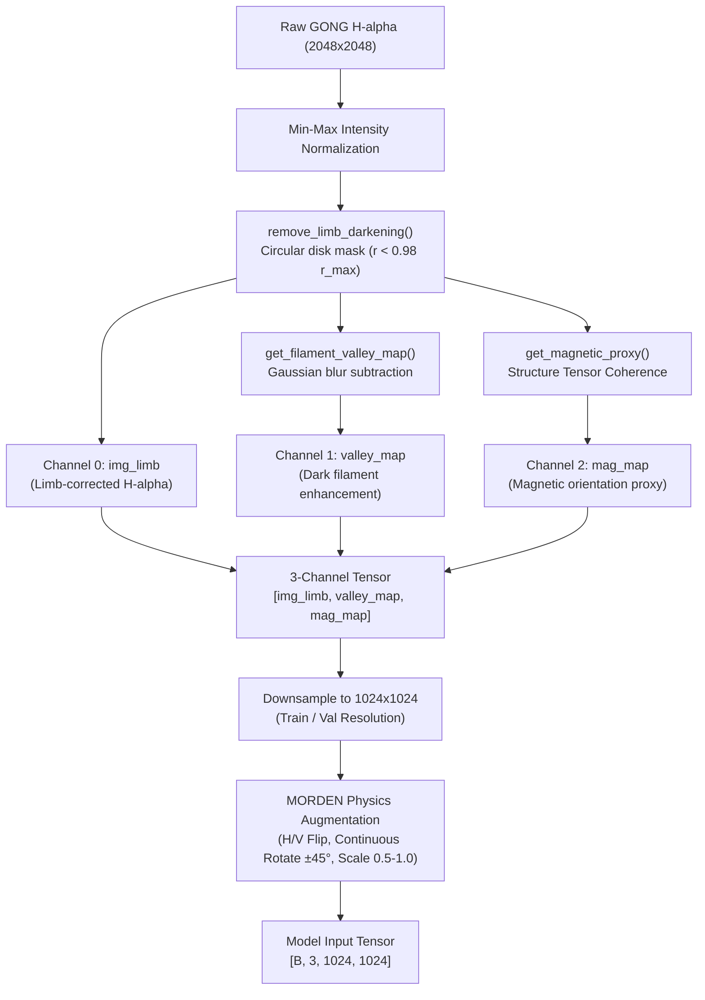
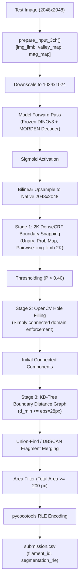
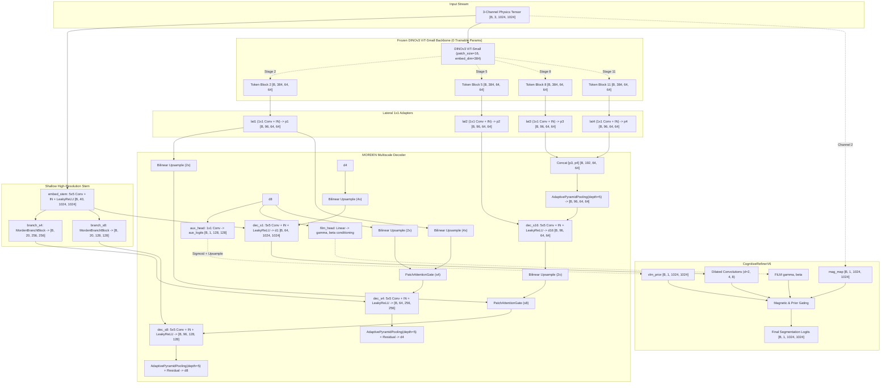
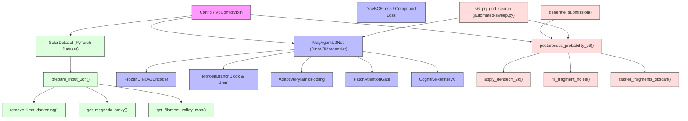

# V6 Model Architecture Analysis: `DinoV3MordenNet`

---

## 1. Executive Summary: What V6 is Doing

The **V6 architecture (`DinoV3MordenNet`)** is a specialized hybrid vision system designed to solve high-precision solar filament instance segmentation under extreme class imbalance (<10% solar disk coverage) and severe training sample scarcity (~few hundred solar disk images).

### The Problem in V1–V5
Earlier iterations (V1 through V5) relied on an oversized, trained-from-scratch **U²-Net RSU encoder ($\sim 21\text{M}$ parameters)**. On a small solar dataset, 21M trainable parameters quickly overfit background granulation, while the heavy receptive fields suffered from GPU VRAM bottlenecks at high resolution ($1024 \times 1024$ and native $2048 \times 2048$). Furthermore, standard connected-component post-processing fragmented long solar filaments, directly penalizing the **Panoptic Quality (PQ)** metric through false-positive instance splits.

### The V6 Solution
V6 eliminates the 21M-parameter overfitting bottleneck by:
1. **Freezing a self-supervised foundation model**: A strictly frozen **DINOv3 ViT-Small** backbone (`0` trainable encoder parameters) provides invariant, generalizable semantic tokens.
2. **Lightweight MORDEN decoder**: A $\sim 2.1\text{M}\text{--}2.3\text{M}$ trainable parameter decoder adopting architectural ablations from the MORDEN paper (Hu et al., 2026)—specifically $5 \times 5$ convolutions, `InstanceNorm2d`, `LeakyReLU(0.01)`, `Dropout2d(0.1)`, and hierarchical `AdaptivePyramidPooling` (APP).
3. **Physics-informed shallow stem**: A dual-stage CNN stem bypasses the ViT patch-16 stride to feed fine-grained filament barbs directly into the decoder.
4. **Topology-preserving Cognitive Refiner**: Dilated convolutions ($d=2, 4, 8$) guided by a magnetic proxy map bridge disjoint filament segments.
5. **Decoupled 2K post-processing cascade**: DenseCRF boundary snapping $\rightarrow$ OpenCV hole filling $\rightarrow$ KD-Tree/DBSCAN spatial clustering to guarantee solid, simply connected filament instances.

---

## 2. Data Processing Pipeline

Solar H-alpha full-disk images from the GONG telescope arrive as $2048 \times 2048$ single-channel intensity maps (8-bit or 16-bit). Standard computer vision models fail when fed raw H-alpha because solar physics introduces strong radial gradients and magnetic alignments that look nothing like ImageNet photographs.



### 2.1 The 3-Channel Physics Tensor
Instead of duplicating the grayscale image across RGB channels, V6 constructs a 3-channel physics tensor:
- **Channel 0 (`img_limb`) — Limb-Corrected Intensity**: The solar disk naturally dims from center to edge (limb darkening), which standard models mistake for large-scale dark filaments. V6 fits a circular mask ($r < 0.98 r_{\text{max}}$) and normalizes intensities inside the disk.
- **Channel 1 (`valley_map`) — Dark-Valley Enhancement**: Filaments are absorption features (darker than the quiet Sun). A large-kernel Gaussian filter ($31 \times 31, \sigma=7$) estimates the background; subtracting the raw image isolates dark valleys without amplifying granulation noise.
- **Channel 2 (`mag_map`) — Magnetic Coherence Proxy**: Filaments form strictly along Polarity Inversion Lines (PILs) of the solar magnetic field. Because real-time magnetograms cannot be used under competition rules, V6 computes the local **Structure Tensor**:
  $$\mathbf{J} = \begin{bmatrix} \langle I_x^2 \rangle & \langle I_x I_y \rangle \\ \langle I_x I_y \rangle & \langle I_y^2 \rangle \end{bmatrix}$$
  The anisotropy (coherence) $C = \sqrt{(\langle I_x^2 \rangle - \langle I_y^2 \rangle)^2 + 4\langle I_x I_y \rangle^2}$ is high along elongated filament spines and low in isotropic granulation noise.

### 2.2 Physics Guardrails in Data Augmentation
Standard data augmentation (e.g., color jitter, gamma shifts) applied indiscriminately to all 3 channels destroys the physical meaning of `mag_map`. 
- **Guardrail**: Geometric transforms (flips, affine rotation $[-45^\circ, +45^\circ]$, scaling $[0.5, 1.0]$) apply across all channels and masks simultaneously.
- **Guardrail**: Photometric alterations (such as random gamma or contrast) are strictly confined to Channel 0 or executed prior to calculating `valley_map` and `mag_map`, ensuring Channel 2 remains bounded in $[0, 1]$.

---

## 3. Training Regime: Pretrained vs. Trained from Scratch

| Component | Status | Parameters | Trainable? | Purpose |
| :--- | :--- | :--- | :--- | :--- |
| **DINOv3 ViT-Small Backbone** | **Pretrained** (`lvd1689m` / `lvd142m`) | $\sim 21.6\text{M}$ | **NO** (`requires_grad = False`) | Generic, robust multi-scale semantic token representation |
| **Shallow CNN Stem & Branch Blocks** | **Trained from scratch** | $\sim 0.12\text{M}$ | **YES** | Preserves high-frequency spatial barbs at stride 1 and 4 |
| **Lateral FPN Adapters (lat1..lat4)** | **Trained from scratch** | $\sim 0.15\text{M}$ | **YES** | Projects DINO tokens (384-dim) into 96-dim FPN channels |
| **Hierarchical APP & PAG Decoder** | **Trained from scratch** | $\sim 1.60\text{M}$ | **YES** | Multi-scale context aggregation and feature gating |
| **Cognitive Refiner V6 & FiLM Head** | **Trained from scratch** | $\sim 0.43\text{M}$ | **YES** | Magnetic proxy gating & multi-dilation gap bridging |
| **Total System** | Hybrid | $\sim 23.9\text{M}$ | **$\sim 2.30\text{M}$ Trainable** | Prevents overfitting while keeping deep semantic features |

### 3.1 Strict Backbone Freezing
The DINOv3 ViT-Small model is loaded via `timm` (`vit_small_patch16_dinov3.lvd1689m`) or HuggingFace (`facebook/dinov3-vits16-pretrain-lvd1689m`). 
1. Every parameter in the backbone has `requires_grad = False`.
2. The backbone's `.train()` method is overridden to permanently force `.eval()`, ensuring transformer LayerNorm statistics and dropout layers never update or drift during training.
3. Patch size 16 cleanly maps a $1024 \times 1024$ input into a $64 \times 64$ patch token grid without spatial interpolation distortion.
4. Tokens are extracted from 4 intermediate transformer depths: blocks `(2, 5, 8, 11)`.

### 3.2 Optimizer Filtering
In `main()`, only parameters with `requires_grad=True` are registered in AdamW:
```python
trainable_params = [p for p in model.parameters() if p.requires_grad]
optimizer = torch.optim.AdamW(trainable_params, lr=2e-4, weight_decay=1e-4)
```
Passing frozen parameters to AdamW would waste GPU memory on unnecessary momentum and variance buffers.

### 3.3 Compound Loss Formulation
Because filaments occupy $<10\%$ of the solar disk, standard Cross-Entropy is ineffective. V6 uses a 5-component compound loss executed in FP32 precision:
$$\mathcal{L}_{\text{total}} = 1.0 \cdot \mathcal{L}_{\text{Dice}} + 1.0 \cdot \mathcal{L}_{\text{Focal}}(\alpha=0.66, \gamma=2.0) + w_{\text{Lovasz}} \cdot \mathcal{L}_{\text{LovaszHinge}} + 0.25 \cdot \mathcal{L}_{\text{SkeletonRecall}} + 0.15 \cdot \mathcal{L}_{\text{AuxBCE}}$$
- **Focal Loss ($\alpha=0.66, \gamma=2.0$)**: Suppresses easy background granulation gradients and focuses training on rare filament pixels.
- **Lovász-Hinge**: Direct surrogate for Jaccard index / IoU optimization.
- **Skeleton Recall Loss**: Computes recall against the 1px-dilated morphological spine/centerline, forcing the network not to sever narrow filament necks.
- **Auxiliary BCE**: Supervised at the intermediate stride-8 ($128 \times 128$) decoder stage to guide early semantic convergence.

---

## 4. Test Dataset Generation & Inference Pipeline

The test dataset consists of unlabeled $2048 \times 2048$ GONG images (`test/test_images/*.jpeg`). Inference is not a simple thresholding step; it employs a multi-stage post-processing cascade:



### 4.1 Native 2K DenseCRF Boundary Snapping
Upsampling predictions from $1024 \times 1024$ to $2048 \times 2048$ produces blurry edges. V6 feeds the 2K probability map as unary energy and the native 2K limb-corrected image (`img_limb_2k`) as pairwise bilateral guide into a DenseCRF:
- **Appearance Bilateral Kernel**:
  $$k^{(1)}(p_i, p_j, I_i, I_j) = w^{(1)} \exp\left(-\frac{|p_i - p_j|^2}{2\theta_\alpha^2} - \frac{|I_i - I_j|^2}{2\theta_\beta^2}\right)$$
  (Hyperparameters from Hu et al.: $w^{(1)}=40$, $\theta_\alpha^2=8$, $\theta_\beta^2=12$).
- **Smoothness Gaussian Kernel**:
  $$k^{(2)}(p_i, p_j) = w^{(2)} \exp\left(-\frac{|p_i - p_j|^2}{2\theta_\gamma^2}\right)$$
  (Hyperparameters: $w^{(2)}=3$, $\theta_\gamma^2=3$, iterations = 10).
This snaps boundaries directly onto high-contrast physical absorption borders.

### 4.2 OpenCV Hole Filling
Filaments are physical plasma ribbons without internal hollow voids. Small thresholding noise can punch holes in large filaments. V6 extracts external contours via `cv2.findContours(..., RETR_EXTERNAL)` and fills them solidly (`cv2.FILLED`), enforcing simply connected topological regions.

### 4.3 DBSCAN Fragment Integration (Panoptic Quality Guard)
In standard pipelines, connected components treats every gap as a new filament instance. If a single solar filament is cut by an optical gap into 3 fragments, connected components generates 3 instances: 1 true positive and 2 false positives, crippling Panoptic Quality ($PQ = SQ \times RQ$).
- V6 extracts boundary contour coordinates for each fragment.
- It builds a spatial `cKDTree` for each component and identifies pairs whose minimum boundary distance $d(C_a, C_b) \le \epsilon$ ($\epsilon \approx 28\text{ px}$).
- A Union-Find / DBSCAN algorithm groups nearby aligned fragments into a single unified instance ID.
- Instances smaller than `MIN_AREA = 200` are discarded as granulation artifacts.

### 4.4 Kaggle Submission Format
Each unified instance mask is encoded via `pycocotools.mask.encode` into an ASCII Run-Length Encoding (RLE) string with the format:
$$\text{filament\_id} = \langle\text{base\_id}\rangle\_\langle\text{instance\_index}\rangle$$
and saved to `submission.csv`.

---

## 5. Architectural Detail of `DinoV3MordenNet`



### 5.1 The MORDEN Innovations Adopted in V6

1. **$5 \times 5$ Convolutions instead of $3 \times 3$**:
   Solar filaments are thin but extremely elongated features spanning hundreds of pixels. A $5 \times 5$ kernel increases effective receptive field growth per stage by 66% with depthwise-separable implementations to minimize parameter overhead.

2. **Instance Normalization (`InstanceNorm2d`)**:
   `BatchNorm2d` computes global batch statistics. In solar images, global brightness varies wildly across instrument exposures, weather at ground stations, and seasonal solar altitude. `InstanceNorm2d` normalizes each image independently, making the model invariant to overall disk contrast shifts.

3. **Hierarchical Adaptive Pyramid Pooling (APP)**:
   Unlike standard ASPP (which uses fixed dilation rates), APP calculates pooling dimensions along an arithmetic progression:
   $$S = \left\{(h_i, w_i) \;\middle|\; h_i = \max\left(\left\lfloor \frac{H \cdot i}{L} \right\rfloor, 1\right),\; w_i = \max\left(\left\lfloor \frac{W \cdot i}{L} \right\rfloor, 1\right),\; i = 1, \dots, L\right\}$$
   with depth $L=5$. It is applied hierarchically across decoder levels ($128 \times 128$, $256 \times 256$) to capture both compact filament knots and long filament arches.

4. **Patch Attention Gate (PAG)**:
   Standard Attention Gates calculate point-wise scalar attention. PAG divides feature maps into dynamic patches of size $S_{\text{patch}} = 2^{\lfloor \log_2 \sqrt{S} \rfloor}$, pooling max and average patch energies to generate joint spatial-channel attention masks that suppress background granulation while passing filament signals.

5. **Cognitive Refiner V6**:
   Receives the full-resolution decoded features, applies multi-scale dilated convolutions ($d=2, 4, 8$), and modulates the bridged representation using FiLM affine transforms ($\gamma, \beta$) derived from the auxiliary semantic head. It gates the output using both the physical `mag_map` and the learned semantic prior.

---

## 6. Graphify Knowledge Graph Representation

The system architecture and file relationships map into a cohesive knowledge graph structure:



### Key Graph Communities & God Nodes
- **Central God Node (`MagAgentU2Net`)**: The core integration hub. In V6, its signature is preserved (`in_ch=3, out_ch=1`, with optional `return_aux=True`) so that existing checkpointing, training loops, and validation harnesses hook in without code breakage.
- **Bridge Node (`postprocess_probability_v6`)**: Connects the continuous probability predictions of the neural network to the discrete instance evaluation metrics (Panoptic Quality).
- **Physics Processing Cluster (`prepare_input_3ch`)**: Serves as the authoritative source of truth for both training batches and test-time evaluation, ensuring zero domain shift in how `mag_map` and `valley_map` are constructed.

---

## 7. Ponytail Synthesis & Key Risks

### What is Skipped / Kept Minimal
1. **No Fine-Tuning of ViT**: We do not unfreeze higher transformer layers. Freezing 100% of DINOv3 keeps trainable parameters at $\sim 2.3\text{M}$ and avoids catastrophic forgetting on a small dataset.
2. **No High-Resolution ViT Inference**: ViT runs at stride 16 ($64 \times 64$ token grid). High-resolution detail ($256 \times 256$ and $1024 \times 1024$) is handled entirely by lightweight CNN branch blocks, avoiding quadratic transformer attention costs.
3. **Decoupled Grid Search**: DenseCRF and DBSCAN parameters are tuned post-hoc via cached stage-by-stage sweeps (`automated-sweep.py`) rather than end-to-end backpropagation.

### Critical Risks & What to Watch
> [!WARNING]
> 1. **DINOv3 Weights Availability**: If running offline in Kaggle without internet, `facebook/dinov3-vits16-pretrain-lvd1689m` must be pre-uploaded as a Kaggle Dataset. The codebase includes a fallback to `vit_small_patch14_dinov2.lvd142m`, but patch size 14 requires spatial interpolation when handling $1024 \times 1024$ inputs ($1024 / 14 \approx 73.14$).
> 2. **DenseCRF Latency**: Running DenseCRF at $2048 \times 2048$ resolution takes $\sim 6.5$ seconds per image. If test set inference exceeds the 9-hour Kaggle limit, either reduce iterations from 10 to 5 or activate the fast bilateral fallback in `code-snippet.py`.
> 3. **DBSCAN $\epsilon$ Calibration**: GONG images have a resolution of $\sim 1.0\text{--}2.0\text{ arcsec/pixel}$. Setting `DBSCAN_EPS` too large ($>45$) merges distinct parallel filaments across active regions; setting it too small ($<15$) leaves fragmented instances, dropping PQ. Use `automated-sweep.py` to lock in $\epsilon$ on the validation set.

